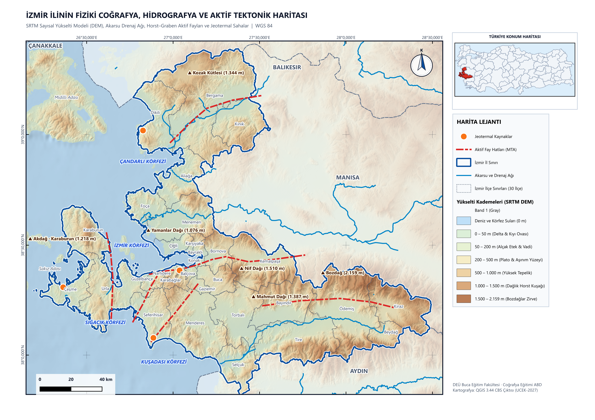
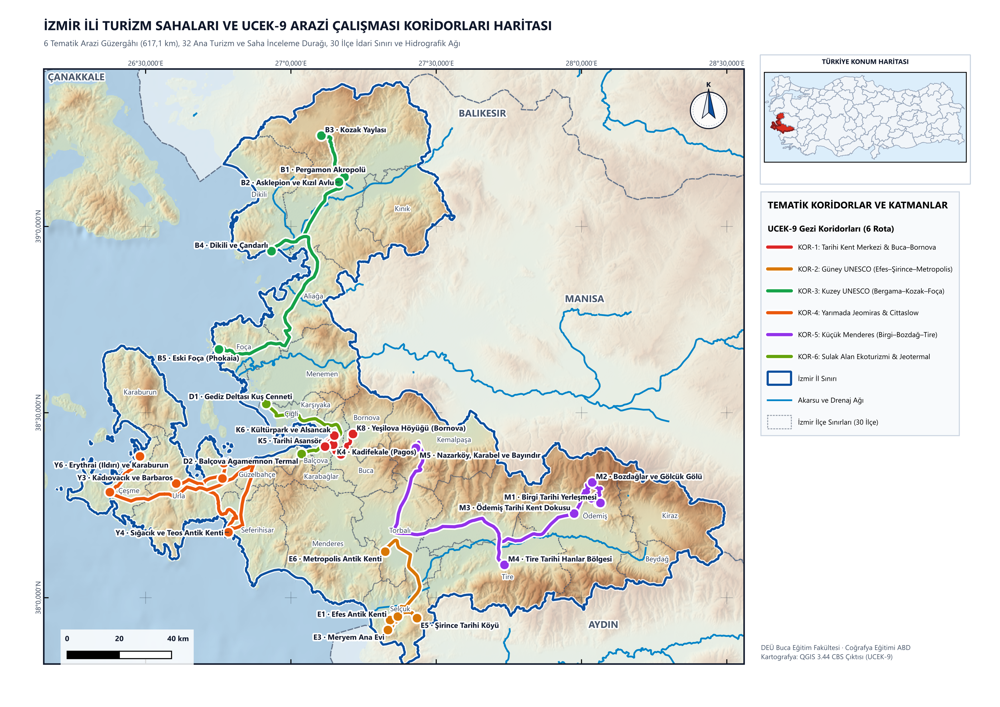

# İzmir İlinin Turizm Sahaları: Doğal-Kültürel Miras Etkileşimi, Mekânsal Kümelenme ve Coğrafya Eğitimi Arazi Çalışmaları Açısından Değerlendirilmesi

**Tourism Areas of İzmir Province: Natural–Cultural Heritage Interaction, Spatial Clustering, and Evaluation in Terms of Geography Education Fieldwork**

**Raziye Çakıcıoğlu Oban¹ · Nesretullah Satar²**
¹ Prof. Dr., Dokuz Eylül Üniversitesi, Buca Eğitim Fakültesi, Coğrafya Eğitimi Anabilim Dalı, İzmir, Türkiye (Proje Yürütücüsü)
² Doktora Öğrencisi, Dokuz Eylül Üniversitesi, Coğrafya Eğitimi Anabilim Dalı, İzmir, Türkiye (CBS Tasarım ve Kartografya)

---

## Öz
Batı Anadolu’nun kıyı kuşağında yer alan İzmir ili; doğu-batı uzanımlı horst-graben tektoniği, Holosen kıyı çizgisi değişimleri, jeotermal kaynakları, sulak alan ekosistemleri ve 8.500 yılı aşan kesintisiz yerleşme tarihiyle doğal ve kültürel turizm çekiciliklerinin yüksek yoğunlukta bütünleştiği çok katmanlı bir coğrafi laboratuvardır. Bu araştırmanın amacı, İzmir il sınırları içerisindeki başlıca turizm sahalarını bilimsel literatür ve Coğrafi Bilgi Sistemleri (CBS) tabanlı mekânsal analizler ışığında sınıflandırmak, doğal süreçler ile kültürel miras arasındaki karşılıklı etkileşimi ortaya koymak ve Eylül 2027’de düzenlenmesi planlanan Ulusal Coğrafya Eğitimi Kongresi (UCEK-2027) kapsamında uygulanabilir tematik arazi çalışması koridorları geliştirmektir. Araştırmada 66 hakemli bilimsel yayın taranarak doğrulanmış, QGIS 3.44 ortamında sayısal yükselti modeli (SRTM 30 m), aktif fay ve jeotermal kaynak katmanları, hidrografik ağ, 30 ilçe idari sınırı ve ulaşım şebekesi bütünleştirilerek mekânsal kümeleme ve ağ analizi gerçekleştirilmiştir. Bulgular, İzmir’deki 32 ana turizm ve saha gözlem durağının (118 alt inceleme noktasıyla birlikte) toplam 617,1 km uzunluğunda altı tematik koridorda kümelendiğini göstermektedir: (1) Tarihi Kent Merkezi, Liman Mirası ve Buca–Bornova Ekseni, (2) Güney UNESCO Kültür Peyzajı (Efes–Ayasuluk–Şirince–Metropolis), (3) Kuzey UNESCO Çok Katmanlı Peyzajı (Pergamon–Kozak–Dikili–Foça), (4) İzmir Yarımadası Jeomiras, Cittaslow ve Bağ Yolu Ekseni, (5) Küçük Menderes Havzası Tarihi Kent ve Yayla Peyzajı (Birgi–Bozdağ–Ödemiş–Tire–Bayındır) ve (6) Körfez Sulak Alan ve Jeotermal Sağlık Kuşağı (Gediz Deltası–Balçova). Sonuç olarak, jeoarkeolojik kıyı evrimi, kırsal mimari koruma ve ekolojik taşıma kapasitesi kavramlarının çift dilli Web CBS tabanlı arazi rehberleriyle desteklenmesinin hem sürdürülebilir turizm planlamasına hem de yükseköğretimde yer temelli coğrafya öğretimine özgün bir metodolojik model sunduğu belirlenmiştir.

**Anahtar Kelimeler:** İzmir turizm coğrafyası, kültür peyzajı, jeoarkeoloji, coğrafya eğitimi, arazi çalışması, Coğrafi Bilgi Sistemleri (CBS), UCEK-2027.

## Abstract
Situated along the central Aegean seaboard of Western Anatolia, İzmir Province constitutes a multi-layered geographical laboratory where east–west-trending horst–graben tectonics, Holocene shoreline migrations, geothermal systems, coastal wetlands, and more than 8,500 years of continuous human settlement converge to generate a dense mosaic of natural and cultural tourism landscapes. This study aims to systematically classify the principal tourism areas of İzmir Province through peer-reviewed scientific literature and Geographic Information Systems (GIS) spatial analysis, elucidate the morphodynamic interactions linking physical geography with cultural heritage, and design structured thematic fieldwork corridors for the National Geography Education Congress scheduled for September 2027 (UCEK-2027). Drawing upon 66 verified scholarly publications, a multi-layered spatial database integrating a 30 m SRTM Digital Elevation Model, active fault and geothermal inventories, hydrographic networks, 30 district boundaries, and road/rail routing was constructed in QGIS 3.44. Spatial synthesis demonstrates that 32 primary tourism and field-observation sites (comprising 118 sub-stops) cluster along six thematic corridors totaling 617.1 km: (1) Historical Urban Core, Port Heritage, and Buca–Bornova Axis; (2) Southern UNESCO Cultural Landscape (Ephesus–Ayasuluk–Şirince–Metropolis); (3) Northern UNESCO Multi-Layered Landscape (Pergamon–Kozak–Dikili–Foça); (4) İzmir Peninsula Geoheritage, Cittaslow, and Vineyard Route; (5) Küçük Menderes Basin Historical Towns and Highland Landscape (Birgi–Bozdağ–Ödemiş–Tire–Bayındır); and (6) Gulf Wetland Ecotourism and Geothermal Health Belt (Gediz Delta–Balçova). Integrating geoarchaeological coastal evolution, vernacular architectural conservation, and ecological carrying capacity within a bilingual Web GIS framework offers a transferable model for both sustainable regional tourism planning and inquiry-based geography fieldwork.

**Keywords:** Tourism geography of İzmir, cultural landscape, geoarchaeology, geography education, fieldwork, Geographic Information Systems (GIS), UCEK-2027.

---

## 1. Giriş

Turizm coğrafyası araştırmalarında çağdaş yaklaşımlar, turistik çekicilikleri birbirinden kopuk noktasal ziyaret durakları olarak değil; jeomorfolojik evrim, hidroklimatik koşullar, biyoçeşitlilik ve tarihsel arazi kullanım pratiklerinin karşılıklı etkileşimiyle biçimlenen bütünleşik kültür peyzajları olarak ele almaktadır (Şimşek, 2017; Çatalbaş ve Ecemiş Kılıç, 2021). Özellikle Akdeniz havzasının kıyı bölgelerinde kitle odaklı deniz-kum-güneş turizminin yarattığı mevsimsel yığılma ve mekânsal baskı; kültür rotalarının, jeomiras alanlarının, agro-turizm ağlarının ve sakin şehir (Cittaslow) uygulamalarının planlı biçimde çeşitlendirilmesini zorunlu kılmaktadır (Yıldırım ve Çakıcıoğlu Oban, 2011; Gündüz, Öner ve Knox, 2016; Süer, 2023). Bu bağlamda bölgesel turizm envanterlerinin yalnızca konaklama veya ziyaretçi istatistikleriyle sınırlandırılmaması, sahayı var eden fiziki ve beşerî coğrafya süreçleriyle birlikte çözümlenmesi büyük önem taşımaktadır.

Batı Anadolu’nun Ege Denizi’ne açılan en önemli metropoliten ve tarihsel düğüm noktasını oluşturan İzmir ili, söz konusu doğal-kültürel miras etkileşiminin Anadolu’daki en seçkin örneklerinden birini sunmaktadır. Tektonik açıdan genç çöküntü olukları (Bakırçay, Gediz ve Küçük Menderes grabenleri) ile bunları sınırlayan yüksek kütlelerin (Bozdağlar, Aydın Dağları, Yunt Dağı, Yamanlar ve Karaburun yükseltileri) kıyıya dik uzanışı; denizel etkilerin iç kesimlere sokulmasını sağlamış, korunaklı koylar, yarımadalar, termal kaynaklar ve verimli alüvyal ovalar dizisi yaratmıştır (Kraft, Brückner, Kayan ve Engelmann, 2006; Öner ve Vardar, 2018; Meriç vd., 2021). Holosen boyunca deniz seviyesi yükselmeleri ve akarsuların taşıdığı alüvyonların körfezleri doldurması; Efes, Elaia, Panaztepe, Teos ve Klazomenai gibi antik liman kentlerinin kaderini doğrudan belirlemiş, fiziki coğrafya süreçlerinin uygarlık tarihi üzerindeki belirleyiciliğini somutlaştırmıştır (Delile vd., 2015; Seeliger vd., 2019; Kayan, Öner, Doğan, İlhan ve Vardar, 2019; Vardar, İlhan ve Öner, 2020).

İzmir’in sahip olduğu bu çok katmanlı coğrafi zenginlik, turizm planlamasının yanı sıra yükseköğretimde coğrafya eğitimi ve arazi çalışmaları açısından da benzersiz pedagojik olanaklar barındırmaktadır. Coğrafya öğretim programlarının temel bileşenlerinden biri olan arazi çalışmaları; soyut mekânsal kavramların doğrudan gözlem yoluyla anlamlandırılmasını, doğa temelli öğrenmenin güçlendirilmesini ve sentez düzeyinde mekânsal düşünme becerilerinin kazanılmasını sağlamaktadır (Brookfield, 2022; Cantürk ve Çakıcıoğlu Oban, 2022). Son yıllarda mobil Coğrafi Bilgi Sistemleri (CBS), etkileşimli web haritaları ve çoklu ortam destekli dijital saha rehberlerinin arazi eğitimine entegre edilmesi, katılımcıların arazi öncesi hazırlık, saha içi konum tabanlı sorgulama ve arazi sonrası değerlendirme süreçlerini niteliksel olarak dönüştürmüştür (Wang, van Elzakker ve Kraak, 2017; Izzah Salsabila, Putra ve Matos, 2022; Lee, 2023).

Bu çalışmanın temel amacı; İzmir ilinin turizm değerine sahip doğal, tarihsel-arkeolojik, kentsel, kırsal ve ekolojik sahalarını hakemli bilimsel literatür temelinde bütüncül olarak incelemek, QGIS tabanlı mekânsal analizlerle tematik turizm ve arazi koridorlarını tanımlamak ve Eylül 2027’de Dokuz Eylül Üniversitesi Buca Eğitim Fakültesi Coğrafya Eğitimi Anabilim Dalı ev sahipliği çerçevesinde gerçekleştirilmesi planlanan Ulusal Coğrafya Eğitimi Kongresi (UCEK-2027) için bilimsel temelli bir gezi ve saha inceleme modeli ortaya koymaktır.

## 2. Araştırma Sahasının Coğrafi Konumu, Jeomorfolojik Evrimi ve Beşerî Temelleri

İzmir ili, Türkiye’nin Ege Bölgesi’nde 37°45'–39°15' kuzey enlemleri ile 26°15'–28°20' doğu boylamları arasında yer almakta olup yaklaşık 11.891 km² yüzölçümüne ve 30 idari ilçeye sahiptir (Şekil 1). Kuzeyde Balıkesir (Madra Dağı eşiği ve Edremit Körfezi güneyi), doğuda Manisa (Spil Dağı, Gediz ve Alaşehir-Salihli olukları batısı) ve güneyde Aydın (Kuşadası Körfezi ve Büyük Menderes kuzey eşiği) illeriyle komşu olan ilin batı sınırını tümüyle Ege Denizi’nin girintili çıkıntılı kıyı kuşağı oluşturmaktadır. Çandarlı, İzmir, Gülbahçe, Sığacık ve Kuşadası körfezleri ile Urla–Çeşme–Karaburun ve Foça yarımadaları, ilin kıyı çizgisinin 629 km’yi aşmasını sağlayarak denizel turizm, kıyı arkeolojisi ve sulak alan biyoçeşitliliği için çok yönlü mekânsal nişler üretmiştir (Koçan ve Balık, 2021; Erdoğan, 2025).

Araştırma sahasının jeomorfolojik çatısını, Menderes Masifi’nin metamorfik çekirdeği (Bozdağlar’da 2.159 m, Aydın Dağları kuzey kanadında 1.600 m üzeri yükseltiler) ile İzmir–Ankara Zonu’na ait Mesozoyik kireçtaşları, filiş istifleri ve Miyosen yaşlı kalkalkalen volkanizma ürünleri (Yamanlar, Yunt Dağı, Foça ve Urla–Alaçatı tüf-andezit örtüleri) oluşturmaktadır (Sümer, Akbulut ve İnaner, 2020; Göktaş, Kaya, Tarhan ve Mayda, 2022). Neotektonik dönemde gelişen batı-doğu ve kuzeydoğu-güneybatı doğrultulu normal ve doğrultu atımlı fay sistemleri (İzmir Fayı, Seferihisar Fayı, Tuzla Fayı, Gülbahçe Fayı ve Bergama–Zeytindağ kırık hatları), bir yandan sarp tektonik yamaçlar ve çöküntü ovaları meydana getirirken diğer yandan Balçova–Narlıdere, Çeşme–Ilıca, Seferihisar–Doğanbey ve Dikili–Bademli’de yüksek entalpili jeotermal kaynakların yüzeye çıkmasını sağlamıştır (Meriç vd., 2021; Turan, Artun ve Saner, 2021).

Hidrografik açıdan saha; kuzeyde Bakırçay, merkez-kuzeyde Gediz Nehri, güneyde ise Küçük Menderes Nehri ve bunların yan kolları tarafından drene edilmektedir. Söz konusu akarsuların taşıdığı alüvyal yük, son 6.000–7.000 yıllık Holosen transgresyonu sonrasında kıyı koylarını hızla doldurarak geniş delta-ova düzlükleri oluşturmuştur (Öner ve Vardar, 2018; Vardar, Kara ve Demirel, 2026). Akdeniz makroiklimi etkisindeki sahada yazların sıcak ve kurak, kışların ılık ve yağışlı geçmesi; kıyıdan itibaren kızılçam (Pinus brutia), maki, garig, Kozak’ta fıstık çamı (Pinus pinea) ve Bozdağlar’ın yüksek kesimlerinde karaçam ve kestane topluluklarının gelişimini desteklemiştir. Bununla birlikte son otuz yıllık süreçte arazi kullanımındaki kentsel yayılma ve kuraklık eğilimleri, kıyı-orman arakesitindeki peyzaj bağlantılılığını ve orman yangını rejiminin yükselti-alan dağılışını doğrudan etkilemektedir (Erdoğan, 2025; Satar, Çakıcıoğlu Oban ve Karadoğan, 2026; Kılıç, Özcan ve Çakıcıoğlu Oban, 2026).

*Şekil 1. İzmir ilinin Türkiye içindeki konumu, yükselti basamakları, drenaj ağı, aktif fay hatları ve başlıca jeotermal kaynaklarının dağılışı (QGIS 3.44 CBS çıktısı).*

## 3. Veri ve Yöntem

Araştırma, nitel doküman-literatür doğrulaması ile nicel CBS mekânsal analiz tekniklerini birleştiren karma bir metodolojik kurguya dayanmaktadır. İlk aşamada, İzmir ilinin turizm coğrafyası, jeoarkeolojisi, jeomirası, kentsel-kırsal mimari mirası, sulak alan ekolojisi, gastronomi kültürü ve coğrafya eğitimi arazi uygulamaları üzerine yayımlanmış ulusal ve uluslararası hakemli literatür taranmıştır. Taranan yayınların DOI kayıtları, yayın bütünlüğü ve atıf bağlamları denetlenerek İzmir il sınırları dışında kalan veya araştırma kapsamıyla örtüşmeyen çalışmalar elenmiş; doğrulanan 66 hakemli bilimsel kaynak çalışma veri tabanına dâhil edilmiştir.

İkinci aşamada, QGIS 3.44 açık kaynaklı CBS yazılımı kullanılarak çok katmanlı bir mekânsal veri tabanı oluşturulmuştur (Tablo 1). Yaklaşık 30 m mekânsal çözünürlüklü SRTM sayısal yükselti modeli (DEM) üzerinden hipsometrik yükselti kademeleri ve çok yönlü gölgeli kabartma (multidirectional hillshade) katmanları üretilmiş; MTA aktif fay hatları ve termal kaynak envanteri, Türkiye ulusal havza ve hidrografik akarsu ağı, 30 ilçe idari sınırları ve raylı-denizel ulaşım şebekesi EPSG:4326 ve EPSG:3857 koordinat sistemlerinde bütünleştirilmiştir.

Üçüncü aşamada, literatür bulguları doğrultusunda belirlenen 32 ana turizm ve saha gözlem durağı (ve bunlara bağlı 86 alt inceleme noktası olmak üzere toplam 118 coğrafi odak) mekânsal yakınlık, havza bütünlüğü, tematik tutarlılık ve karayolu ulaşım sürekliliği ölçütlerine göre kümelendirilmiştir. Duraklar arasındaki gerçek karayolu güzergâhları OSRM ağ analiziyle hesaplanarak 617,1 km toplam uzunluğa sahip altı tematik arazi koridoru oluşturulmuş; üretilen kartografik çıktılar hem basılı saha rehberine hem de açık kaynaklı çift dilli (Türkçe/İngilizce) Web CBS platformuna aktarılmıştır.

*Tablo 1. Araştırmada Kullanılan Coğrafi Bilgi Sistemleri (CBS) Katmanları, Çözünürlük ve Veri Kaynakları*

| Katman Adı | Veri Tipi | Mekânsal Kapsam / Ölçek | Temel Analitik Kullanım Amacı |
| :--- | :--- | :--- | :--- |
| Sayısal Yükselti Modeli (SRTM DEM) | Raster (GeoTIFF) | ~30 m / İzmir ve çevresi | Hipsometrik yükselti kademeleri, eğim ve morfolojik kesit analizi |
| Çok Yönlü Gölgeli Kabartma | Raster (GeoTIFF) | ~30 m (GDAL çok yönlü) | Horst-graben tektoniği, vadi yarılması ve kıyı rölyefinin görselleştirilmesi |
| İdari Sınırlar (Türkiye 81 İl ve İzmir 30 İlçe) | Vektör (Poligon) | 1:100.000 ulusal sınır verisi | Konum haritası, ilçe bazlı turizm dağılışı ve nüfus-alan ilişkilendirmesi |
| Hidrografik Ağ ve Nehir Havzaları | Vektör (Çizgi/Poligon) | Bakırçay, Gediz, K. Menderes | Alüvyal delta ilerlemesi, sulak alanlar ve vadi koridorlarının analizi |
| Aktif Fay Hatları ve Termal Kaynaklar | Vektör (Çizgi/Nokta) | MTA diri fay ve jeotermal serisi | Tektonik jeomiras, fay diklikleri ve termal sağlık turizmi korelasyonu |
| Turizm Sahaları ve Alt İnceleme Noktaları | Vektör (Nokta) | 32 ana saha / 118 alt nokta | Literatür tabanlı tematik sınıflandırma, kümeleme ve Web CBS sorgulama |
| Arazi Güzergâhları ve Raylı/Denizel Ağ | Vektör (Çizgi) | 6 koridor (617,1 km, OSRM) | Kongre arazi çalışması lojistiği, mesafe-süre hesabı ve toplu ulaşım entegrasyonu |

## 4. Bulgular: İzmir İlinin Başlıca Turizm Sahaları ve Mekânsal Kümelenmesi

CBS tabanlı mekânsal dağılış analizi, İzmir ilindeki turistik çekiciliklerin rastlantısal bir dağılış göstermediğini; aksine tektonik uzanımlar, nehir havzaları, tarihsel liman koyları ve kentsel ulaşım koridorları boyunca belirgin mekânsal kümelenmeler oluşturduğunu ortaya koymaktadır (Şekil 2). Bu doğrultuda tanımlanan altı tematik turizm ve arazi çalışması koridorunun temel mekânsal ve lojistik göstergeleri Tablo 2’de, 32 ana turizm sahasının ayrıntılı coğrafi sınıflandırması ise Tablo 3’te sunulmuştur.

*Şekil 2. İzmir ilindeki 32 ana turizm sahasının 6 tematik arazi çalışması koridoru (KOR-1 – KOR-6) boyunca mekânsal kümelenmesi (QGIS 3.44 CBS çıktısı).*

*Tablo 2. İzmir İli Tematik Turizm ve Arazi Çalışması Koridorlarının Mekânsal ve Lojistik Sentezi*

| Koridor Kodu ve Başlığı | Kapsanan İlçeler | Ana Durak | Yol Uzunluğu | Önerilen Süre | Baskın Coğrafi ve Turistik Tema |
| :--- | :--- | :---: | :---: | :---: | :--- |
| **KOR-1:** Tarihi Kent Merkezi, Liman Mirası ve Buca–Bornova | Konak, Buca, Bornova, Bayraklı | 8 | 42,6 km | Tam / Yarım Gün | Kentsel arkeoloji, Kemeraltı, kıyı dolgusu, Levanten mirası ve Neolitik höyükler |
| **KOR-2:** Güney UNESCO Kültür Peyzajı (Efes–Şirince–Metropolis) | Selçuk, Torbalı | 6 | 74,4 km | Tam Gün | Küçük Menderes delta jeoarkeolojisi, UNESCO antik kenti, inanç ve kırsal mimari |
| **KOR-3:** Kuzey UNESCO Çok Katmanlı Peyzajı (Bergama–Kozak–Foça) | Bergama, Dikili, Foça | 5 | 159,5 km | Tam Gün | Akropol jeomorfolojisi, antik tıp, fıstık çamı yaylası, jeotermal ve denizel ÖÇKB |
| **KOR-4:** İzmir Yarımadası Jeomiras, Cittaslow ve Bağ Yolu | Urla, Seferihisar, Çeşme, Karaburun | 6 | 157,8 km | Tam Gün | Denizel jeoarkeoloji, jeositler, karstik kuyular, Cittaslow, bağ yolu ve rüzgâr sörfü |
| **KOR-5:** Küçük Menderes Havzası (Birgi–Bozdağ–Ödemiş–Tire–Bayındır) | Ödemiş, Tire, Bayındır, Kemalpaşa | 5 | 133,6 km | Tam Gün | Beylik-Osmanlı konak mimarisi, dağ-set gölü, dokuma zanaatı ve florikültür havzası |
| **KOR-6:** Körfez Sulak Alan Ekoturizmi ve Jeotermal Sağlık Kuşağı | Çiğli, Menemen, Balçova, Narlıdere | 2 | 49,2 km | Yarım Gün | Ramsar delta sulak alanı, tuzla ekolojisi, İzmir Fayı ve Agamemnon jeotermal sahası |
| **TOPLAM / GENEL SENTEZ** | **19 Doğrudan / 30 İl Geneli** | **32** | **617,1 km** | **6 Modüler Rota** | **Doğal-kültürel miras etkileşimi ve yer temelli coğrafya arazi eğitimi** |

### 4.1. Tarihi Kent Merkezi, Liman Mirası ve Buca–Bornova Ekseni

İzmir Körfezi’nin iç kesimini çevreleyen birinci küme (KOR-1; 42,6 km, 8 ana durak), kentin Neolitik Çağ’dan Cumhuriyet dönemine uzanan 8.500 yıllık mekânsal sürekliliğini temsil etmektedir. Bornova Ovası’nın alüvyal konisi üzerinde konumlanan Yeşilova Höyüğü (K8), MÖ 6500’lere inen mimari tabakalarıyla Kıyı Ege’nin en eski yerleşik köy yaşamını ve denizel-akarsu çevreye uyumu belgelemektedir (Derin, 2023). Hemen kuzeybatısındaki Bayraklı Höyüğü (Tepekule / Eski Smyrna) ise Arkaik dönemde kentin savunulabilir bir yarımada-tepe üzerinde nasıl örgütlendiğini ve gelişkin metal işçiliğini ortaya koymaktadır (Erdem, 2021). Büyük İskender sonrası dönemde kentin Pagos Tepesi (Kadifekale, K4; 186 m) eteklerine taşınması, volkanik-andezitik kütlenin sağladığı doğal savunma üstünlüğü ve iç körfeze hâkim liman konumuyla doğrudan ilişkilidir.

Pagos’un kuzey yamacında kurulan Smyrna Antik Kenti Agorası (K3) ve onun kuzeybatısında hilal biçimli eski iç limanın zamanla dolmasıyla şekillenen Tarihi Kemeraltı Çarşısı, Kızlarağası Hanı ve Havra Sokağı (K2), kentsel jeoarkeoloji ile ticari kültür mirasının iç içe geçtiği nadir örneklerdendir. Karadaş, İlhan, Vardar, Öner ve Ersoy (2023) tarafından gerçekleştirilen delgi sondajları, Agora çevresindeki Holosen kıyı çizgisi gerilemesinin Osmanlı döneminde Kemeraltı ticaret dokusunun kıyıya doğru büyümesine zemin hazırladığını kanıtlamaktadır; Savaşır (2020) ise bu dokunun han, bedesten, cami, sinagog ve kiliselerden oluşan çok kültürlü belleğini haritalamıştır. Konak Meydanı, İzmir Saat Kulesi ve Yalı Camii (K1) ile Alsancak–Kültürpark ekseni (K6), 19. yüzyıl rıhtım dolgularından Cumhuriyet’in modern kamusal mekân ve endüstriyel miras dönüşümüne (Tarihi Havagazı Fabrikası, Alsancak Garı) uzanan simgesel kıyı bandını oluşturmaktadır (Yılmaz, 2018; Özbey ve Güneş, 2021; Erdoğan ve Eldek Güner, 2023; Parlapan, Ecemiş Kılıç ve Efe Güney, 2023). Karataş kıyı falezini aşmak üzere 1907’de inşa edilen Tarihi Asansör (K5) kentsel topoğrafya-mühendislik uyumunu ve Sefarad-gastronomi mirasını (Erdoğan ve Özdemir, 2018; Çakmak, 2022; Can Gaberli, Gaberli ve Genç, 2023) yansıtırken; Buca’daki 19. yüzyıl Levanten köşkleri ve Dokuz Eylül Üniversitesi Buca Eğitim Fakültesi yerleşkesi (K7), banliyö demiryolu ile gelişen tarihsel peyzajın yükseköğretim kurumu olarak yeniden işlevlendirilmesini temsil etmektedir (Dinçer, 2020; Cantürk ve Çakıcıoğlu Oban, 2022; Mumcu ve İzmir Tunahan, 2024).

### 4.2. Güney UNESCO Kültür Peyzajı: Küçük Menderes Deltası, Efes, Ayasuluk, Şirince ve Metropolis

İzmir’in güneyinde Selçuk ve Torbalı ilçelerini kapsayan ikinci küme (KOR-2; 74,4 km, 6 ana durak), 2015 yılında UNESCO Dünya Mirası Listesi’ne kaydedilen Efes Kültür Peyzajı’nı merkeze almaktadır. Bu sahanın turizm coğrafyası ve arazi eğitimi açısından en çarpıcı yönü, Küçük Menderes (Kaystros) Nehri’nin taşıdığı alüvyonların son birkaç binyılda kıyı çizgisini 6 ila 9 km batıya doğru ilerleterek antik koyu alüvyal ovaya dönüştürmüş olmasıdır (Kraft vd., 2006). Prehistorik Çukuriçi Höyük’ten (E4; Cveček, 2022) Arkaik Artemision ve Ayasuluk Tepesi’ne (E2), oradan Helenistik-Roma Efes kent merkezine (E1) uzanan yerleşme yeri değişimleri, doğrudan bu delta ilerlemesi ve liman sığlaşmasına verilen mekânsal yanıtlardır. Delile vd. (2015), Efes antik liman tortullarında yaptıkları jeokimyasal analizlerle Roma ve Bizans dönemlerindeki yoğun havza erozyonu ile liman işlevinin kaybı arasındaki nedensel bağı ayrıntılı biçimde ortaya koymuştur.

Ayasuluk Tepesi üzerindeki St. Jean Bazilikası, Aydınoğulları döneminin anıtsal eseri İsa Bey Camii ve Bülbül Dağı orman ekosistemi içerisindeki Meryem Ana Evi (E3), sahanın Hristiyanlık ve İslam tarihindeki kesintisiz inanç turizmi kimliğini güçlendirmektedir (Şimşek, 2017; Wilson, 2026). Bunun yanında Selçuk’taki geleneksel deve güreşi festivalleri gibi somut olmayan kültürel miras unsurları ile profesyonel turist rehberliğinin miras yorumlamasındaki rolü, destinasyonun uluslararası çekiciliğini çeşitlendirmektedir (Çalışkan, 2010; Yavuz Çetinkaya ve Öter, 2015). Doğu yamaçta konumlanan Şirince Tarihi Kırsal Yerleşmesi (E5), topografyaya uyumlu taş-ahşap konut mimarisi ve bağ-meyve bahçeleriyle sürdürülebilir kırsal yapı ilkelerinin canlı bir örneğini sunarken (Koca, 2019); koridorun kuzey eşiğinde Torbalı Ovası’na hâkim Metropolis Antik Kenti (E6), hem Smyrna–Efes antik ana yolunu denetleyen stratejik konumu hem de deneysel arkeoloji eğitimi uygulamalarıyla öne çıkmaktadır (Aybek, Arslan ve Menteşe, 2023; Kılıç vd., 2026).

### 4.3. Kuzey Çok Katmanlı Kültür Peyzajı: Bakırçay Havzası, Pergamon, Kozak Yaylası, Dikili ve Foça

Bakırçay Grabeni ve kuzey kıyı kuşağını kapsayan üçüncü küme (KOR-3; 159,5 km, 5 ana durak), 2014 yılında UNESCO Dünya Mirası Listesi’ne alınan Bergama Çok Katmanlı Kültürel Peyzaj Alanı ile Dikili ve Foça kıyı yerleşmelerini bütünleştirmektedir. Bakırçay Ovası’ndan yaklaşık 300 m yükselen sarp andezitik masa-tepe üzerinde kurulan Pergamon Akropolü (B1); yamaç eğimine uyarlanmış dünyanın en dik antik tiyatrosu, kütüphanesi, Trajaneum terası ve Madradağ’dan basınçlı boru hatlarıyla su taşıyan mühendislik sistemiyle topoğrafyanın anıtsal kentsel tasarıma dönüştürüldüğü eşsiz bir örnektir (Mirza, 2016; Okyay ve Ulusoy Binan, 2022). Kentin eteklerinde yer alan Asklepion Antik Sağlık Merkezi ve Bergama Çayı’nı çift tünel tonozla aşan Kızıl Avlu (Serapeion, B2), antik tıp coğrafyası ile Roma mühendisliğini bir araya getirmektedir.

Pergamon’un kuzeybatısında yükselen Kozak Yaylası (B3), granitoyid batolitinin fiziksel ayrışmasıyla oluşan kubbemsi blok topoğrafyası (tor topografyası) üzerinde gelişen Türkiye’nin en önemli fıstık çamı agro-ekosistemini barındırmakta; güneybatı kıyıdaki Elaia antik limanı ise tıpkı Efes’te olduğu gibi kıyı çizgisi göçü ve sığlaşma süreçlerini belgelemektedir (Seeliger vd., 2019). Batı kıyıya inildiğinde Dikili–Bademli kuşağı ve Çandarlı Kalesi (B4), tektonik kırık hatlarına bağlı jeotermal kaynak potansiyeli ve kıyı savunma mimarisiyle dikkat çekmektedir (Turan vd., 2021). Koridorun güney ucundaki Eski Foça (Phokaia) Özel Çevre Koruma Bölgesi ve Kozbeyli Köyü (B5) ise Miyosen piroklastik kayaçların oluşturduğu adalı kıyı morfolojisi, Akdeniz foku (Monachus monachus) denizel koruma alanları, eko-kentsel planlama yaklaşımları ve kırsal taş mimari turizmiyle bütünleşik bir kıyı-kırsal koruma modeli sunmaktadır (Sonuç, 2018; Koçan ve Balık, 2021; Saf, 2022).

### 4.4. İzmir Yarımadası: Jeomiras, Cittaslow, Bağcılık ve Kıyı Turizmi Sahaları

İzmir Körfezi’nin batısına doğru uzanan Urla–Çeşme–Seferihisar–Karaburun yarımada sistemi (KOR-4; 157,8 km, 6 ana durak), jeomiras, denizel arkeoloji, sakin şehir (Cittaslow), bağcılık ve kıyı sporları turizminin en yoğun çeşitlendiği sahayı oluşturmaktadır. Urla İskele’deki Liman Tepe ve Klazomenai antik kenti ile karşısındaki Karantina Adası (Y1), Tunç Çağı’ndan Arkaik döneme kıyı tektoniği ve deniz seviyesi değişimlerinin liman yapılarını nasıl suya gömdüğünü gösterirken, Anadolu’nun bilinen en eski zeytinyağı işliklerinden birine ve 19. yüzyıl Osmanlı deniz karantina mirasına ev sahipliği yapmaktadır (Kayan vd., 2019). İç kesimde Urla Bağ Yolu ve jeosit aday alanları (Y2), Miyosen volkano-sedimanter oluşumları modern bağcılık, gastronomi ve zeytinyağı müzeciliğiyle buluşturmaktadır (Pırnar, Kurtural ve Eriş, 2019; Sümer vd., 2020).

Yarımadanın orta kesiminde yer alan Kadıovacık ve Barbaros köyleri (Y3), karstik kireçtaşı akiferinden beslenen tarihi su kuyularının hidrojeolojik jeomiras değeri ile yerel halk katılımlı kırsal turizm uygulamalarını birleştirmektedir (Baykal, Yıldız ve Ataberk, 2020; Yüceer vd., 2021). Güney kıyıda 2009 yılında Türkiye’nin ilk Cittaslow kenti unvanını alan Seferihisar, Sığacık Kalesi ve Teos Antik Kenti (Y4); yerel üretici pazarları ve sosyal dirençlilik politikalarının yanı sıra Teos’un kuzey ve güney limanlarında yürütülen paleocoğrafya araştırmalarıyla kıyı değişimi-yerleşme ilişkisini gözler önüne sermektedir (Gündüz vd., 2016; Çalışkan, 2017; Vardar vd., 2020; Süer, 2023). Batı uçta Alaçatı ve Çeşme (Y5), piroklastik tüf taş mimarisi (Taşcı, 2025), sığ koy morfolojisi ve yaz meltemiyle dünya çapında öne çıkan rüzgâr sörfü destinasyonu (Aktaş, Atrek ve Kurt, 2015) ve Bağlararası Tunç Çağı kıyı yerleşmesiyle (Vardar, Öner ve İlhan, 2017) temsil edilmekte; kuzeye yönelen kıyı hattında ise Erythrai (Ildırı) Antik Kenti ve Karaburun Yarımadası (Y6), Roma dönemi ticari amfora üretimi ile Geç Miyosen omurgalı fosil yatakları ve riyolitik kıyı jeomirasını bir araya getirmektedir (Göktaş vd., 2022; Kırkanlı, 2022).

### 4.5. Küçük Menderes Havzası İç Kesimi ve Körfez Sulak Alan–Jeotermal Ekosistemleri

İzmir’in doğu iç kesimindeki Küçük Menderes Havzası (KOR-5; 133,6 km, 5 ana durak) ile Körfez kıyı sulak alan-jeotermal kuşağı (KOR-6; 49,2 km, 2 ana durak), ilin kıyı ötesi kırsal-tarihsel derinliğini ve ekolojik hassasiyetini yansıtmaktadır. Bozdağlar’ın güney eteğinde yarılmış alüvyal koni ve vadi yamaçları üzerine yerleşen Birgi (M1), Aydınoğulları Beyliği başkent mirası (Ulu Cami) ve 18. yüzyıl Çakırağa Konağı ile yeryüzü şekillerinin tarihsel mahalle dokusunu nasıl biçimlendirdiğini kanıtlamakta; aynı zamanda yerel halkın kırsal turizm yönetimine katılımı açısından örnek oluşturmaktadır (Ünal ve Yücel, 2018; Kaya, Vardar ve Kara, 2024). Birgi’den kuzeye tırmanan dik profil, 1.050 m yükseltideki Gölcük alüvyal set gölü ve Bozdağlar yayla kuşağına (M2) ulaşmakta; burada doğal dikey bitki örtüsü kuşaklanmasının yanı sıra Aydınoğulları ve Osmanlı dönemlerine ait yayla saraylarının arkeolojik izleri gözlemlenmektedir (Güzel, Sevin, Vardar ve Güler, 2022). Havza tabanında Ödemiş (M3; Vardar, 2017) ve güney yamaçta Tire Tarihi Hanlar Bölgesi (M4), geleneksel ipek ve beledi dokumacılığı ile mobil dijital miras rotalarının (TiREASURE) yaşatıldığı tarihsel ticaret merkezleridir (Şirin Yaşar ve Önlü, 2022; Gülkaya ve Hamamcıoğlu Turan, 2026). Kuzeybatı bağlantısında ise Bayındır süs bitkileri yetiştiriciliği ile Kemalpaşa Karabel Hitit-Luvi kaya anıtı ve Nazarköy cam boncuk ocakları (M5), tarımsal coğrafya ve zanaat turizmini bütünleştirmektedir (Yıldırım ve Çakıcıoğlu Oban, 2011).

Son olarak İzmir Körfezi’nin kuzeybatı ve güney kıyılarını birbirine bağlayan altıncı koridor (KOR-6), deltalar ve aktif fay hatlarının güncel ekolojik ve ekonomik işlevlerini sergilemektedir. Uluslararası Ramsar Sözleşmesi kapsamındaki Gediz Deltası Sulak Alanı, İzmir Kuş Cenneti, Homa Dalyanı ve Çamaltı Tuzlası (D1); flamingolar başta olmak üzere yüzlerce su kuşu türüne yaşama ortamı sağlarken, Panaztepe’den Çiğli–Mavişehir’e uzanan kıyı çizgisi ilerlemesini ve kentleşme baskısına karşı koruma önceliklerini görünür kılmaktadır (Koru ve Perçin, 2018; Öner ve Vardar, 2018; Arslan, Çiçek, Döndüren ve Ernoul, 2021; Vardar vd., 2026). Körfezin tam karşısında, aktif İzmir Fayı’nın oluşturduğu sarp morfolojik diklik önünde yükselen Balçova–Narlıdere Jeotermal Sahası (Agamemnon Kaplıcaları) ve İnciraltı–Çakalburnu Lagünü (D2) ise antik çağdan günümüze uzanan termal sağlık turizmini, Türkiye’nin öncü kentsel jeotermal konut ısıtma sistemini ve kıyı lagün rehabilitasyonunu aynı saha kesitinde buluşturmaktadır (Meriç vd., 2021; Sancar, 2023; Erdoğan, 2025).

*Tablo 3. İzmir İli 32 Ana Turizm Sahasının Coğrafi Sınıflandırması ve Arazi Eğitimi Gözlem Değerleri*

| Kod | Turizm ve Saha İnceleme Durağı | İlçe | Koridor | Koordinat ve Rakım | Baskın Turizm ve Miras Tipolojisi | Arazi Çalışması Gözlem Odağı |
| :---: | :--- | :--- | :---: | :--- | :--- | :--- |
| **K1** | Konak Meydanı, İzmir Saat Kulesi ve Yalı Camii | Konak | KOR-1 | 38.4189°K, 27.1287°D (4 m) | Kentsel Simge ve Kıyı Meydanı | Osmanlı geç dönem kamusal mimarisi ve kıyı dolgu çizgisi değişimi |
| **K2** | Tarihi Kemeraltı Çarşısı, Kızlarağası Hanı ve Havra Sokağı | Konak | KOR-1 | 38.4215°K, 27.1334°D (8 m) | Tarihi Çarşı, Han ve İnanç Mirası | Antik iç liman dolgu morfolojisi, han tipolojisi ve çok kültürlü ticaret |
| **K3** | Smyrna Antik Kenti Agorası | Konak | KOR-1 | 38.4179°K, 27.1386°D (24 m) | Kentsel Arkeoloji (Roma Agorası) | Pagos eteği kaynak su kehrizleri, bazilika mimarisi ve Holosen kıyı evrimi |
| **K4** | Kadifekale (Pagos Tepesi) Jeomorfolojik Seyir Noktası | Konak | KOR-1 | 38.4136°K, 27.1456°D (186 m) | Jeomorfolojik Seyir ve Kale | Andezitik-dasitik Pagos kütlesi, İzmir Fayı ve Körfez tektonik panoraması |
| **K5** | Tarihi Asansör (Karataş) ve Dario Moreno Sokağı | Konak | KOR-1 | 38.4086°K, 27.1175°D (52 m) | Kentsel Ulaşım ve Levanten Mirası | Falez dikliği aşımı, teraslanmış kıyı morfolojisi ve 20. yy konut dokusu |
| **K6** | Kültürpark, APİKAM Kent Arşivi ve Alsancak Liman Arkası Endüstriyel Mirası | Konak / Alsancak | KOR-1 | 38.4382°K, 27.1494°D (6 m) | Cumhuriyet Dönemi ve Endüstriyel Miras | 1922 sonrası planlı yeşil alan, fuarcılık belleği ve liman ardı sanayi mirası |
| **K7** | DEÜ Buca Eğitim Fakültesi ve Buca Tarihi Levanten Köşkleri | Buca | KOR-1 | 38.3875°K, 27.1722°D (95 m) | Eğitim Kurumu ve Banliyö Köşkleri | DEÜ Buca Eğitim yerleşkesi, 19. yy Levanten bahçe-köşk dokusu ve demiryolu |
| **K8** | Bornova Yeşilova Höyüğü (8.500 Yıl) ve Bayraklı Tepekule (Eski Smyrna) | Bornova / Bayraklı | KOR-1 | 38.4427°K, 27.2137°D (28 m) | Prehistorik Höyük ve Arkaik Yerleşme | Bornova alüvyal konisi üzerinde 8.500 yıllık Neolitik yerleşme sürekliliği |
| **E1** | Efes Antik Kenti (Celsus Kütüphanesi, Yamaç Evler ve Antik Liman) | Selçuk | KOR-2 | 37.9391°K, 27.3414°D (36 m) | UNESCO Dünya Mirası Antik Kent | Küçük Menderes deltası alüvyal boğulması ve Roma liman kenti morfolojisi |
| **E2** | Ayasuluk Tepesi: St. Jean Bazilikası, İsa Bey Camii ve Artemision | Selçuk | KOR-2 | 37.9531°K, 27.3677°D (72 m) | Çok Katmanlı Kutsal Tepe ve Kale | Ayasuluk tepesi stratigrafisi, Artemision, St. Jean ve Aydınoğulları mimarisi |
| **E3** | Meryem Ana Evi ve Bülbül Dağı Akdeniz Orman Ekosistemi | Selçuk | KOR-2 | 37.9122°K, 27.3339°D (380 m) | İnanç Turizmi ve Orman Ekosistemi | Bülbül Dağı kızılçam-maki vejetasyonu, hac turizmi ve yangın dirençliliği |
| **E4** | Çukuriçi Höyük, Efes Müzesi ve Çamlık Buharlı Lokomotif Müzesi | Selçuk | KOR-2 | 37.9489°K, 27.3680°D (22 m) | Arkeoloji ve Demiryolu Mirası | Çukuriçi Höyük metalürjisi, Efes Müzesi koleksiyonu ve Çamlık demiryolu mirası |
| **E5** | Şirince Tarihi Kırsal Yerleşmesi ve Sürdürülebilir Yamaç Mimarisi | Selçuk | KOR-2 | 37.9444°K, 27.4342°D (350 m) | Kırsal Mimari ve Kültür Turizmi | Sürdürülebilir taş-ahşap yamaç yerleşmesi, bağ-meyve terasları ve taşıma kapasitesi |
| **E6** | Metropolis Antik Kenti (Torbalı) ve Küçük Menderes Kuzey Eşik Peyzajı | Torbalı | KOR-2 | 38.1247°K, 27.3247°D (145 m) | Akropol Yerleşmesi ve Havza Eşiği | Torbalı Ovası–Küçük Menderes koridoruna hâkim Helenistik-Roma savunma konumu |
| **B1** | Bergama (Pergamon) Akropolü, Dik Tiyatro ve Trajaneum | Bergama | KOR-3 | 39.1322°K, 27.1842°D (335 m) | UNESCO Çok Katmanlı Akropol | Andezitik masa-tepe jeomorfolojisi, dik yamaç tiyatrosu ve su mühendisliği |
| **B2** | Asklepion Antik Sağlık Merkezi, Kızıl Avlu (Serapeion) ve Bergama Arastası | Bergama | KOR-3 | 39.1186°K, 27.1653°D (92 m) | Antik Tıp Merkezi ve Anıtsal Tapınak | Asklepion sağlık kompleksi, Bergama Çayı tonozları üzerindeki Kızıl Avlu |
| **B3** | Kozak Yaylası Fıstık Çamı Ekosistemi ve Elaia Antik Limanı | Bergama | KOR-3 | 39.2425°K, 27.1050°D (620 m) | Agro-Ekoturizm ve Antik Liman | Granitoyid batolit ayrışma topoğrafyası, fıstık çamı ekonomisi ve Elaia limanı |
| **B4** | Dikili Jeotermal Kıyı Kuşağı ve Çandarlı Kalesi | Dikili | KOR-3 | 38.9339°K, 26.9333°D (12 m) | Jeotermal Kıyı ve Kıyı Kalesi | Tektonik kırık kontrollü jeotermal kaynaklar ve Çandarlı Ceneviz-Osmanlı kalesi |
| **B5** | Eski Foça (Phokaia) Özel Çevre Koruma Bölgesi ve Kozbeyli Taş Köyü | Foça | KOR-3 | 38.6703°K, 26.7525°D (15 m) | ÖÇKB Denizel ve Kırsal Taş Miras | Tüf-andezit kıyı jeomorfolojisi, Akdeniz foku habitatı ve Kozbeyli taş mimarisi |
| **Y1** | Urla Klazomenai Zeytinyağı İşliği, Liman Tepe ve Karantina Adası | Urla | KOR-4 | 38.3639°K, 26.7689°D (10 m) | Denizel Arkeoloji ve Karantina Mirası |  Tunç Çağı kıyı batığı, antik zeytinyağı işliği ve 19. yy Osmanlı tahaffuzhanesi |
| **Y2** | Urla Jeositleri, Bağ Yolu, Sanat Sokağı ve Köstem Zeytinyağı Müzesi | Urla | KOR-4 | 38.3225°K, 26.7644°D (68 m) | Jeomiras, Bağ Yolu ve Müzecilik | Miyosen tortul-volkanik jeositler, bağcılık agro-turizmi ve zeytinyağı teknolojisi |
| **Y3** | Kadıovacık Karstik Su Kuyuları Jeomirası ve Barbaros Köyü | Urla | KOR-4 | 38.3089°K, 26.6053°D (235 m) | Hidrojeolojik Miras ve Kırsal Kültür | Karstik kireçtaşı su kuyuları jeomirası ve Barbaros köyü somut olmayan mirası |
| **Y4** | Seferihisar (Türkiye’nin İlk Cittaslow Kenti), Sığacık Kalesi ve Teos Antik Kenti | Seferihisar | KOR-4 | 38.1772°K, 26.7850°D (18 m) | Cittaslow ve Antik Liman Kenti | Türkiye’nin ilk sakin kenti yönetimi, Sığacık Kalesi ve Teos çift liman jeoarkeolojisi |
| **Y5** | Alaçatı Tarihi Taş Mimarisi, Rüzgâr Sörfü Koyu ve Çeşme Kalesi | Çeşme | KOR-4 | 38.2856°K, 26.3769°D (24 m) | Kıyı Rüzgâr Sporu ve Taş Mimari | Piroklastik tüf taş konut dokusu, rüzgâr koridoru mikroiklimi ve Çeşme Kalesi |
| **Y6** | Erythrai (Ildırı) Antik Kenti ve Karaburun Yarımadası Jeomirası | Çeşme / Karaburun | KOR-4 | 38.3822°K, 26.4806°D (45 m) | Arkaik Kıyı Kenti ve Yarımada Jeolojisi | Erythrai amfora üretimi, riyolitik domlar ve Karaburun Neojen stratigrafisi |
| **M1** | Birgi Tarihi Yerleşmesi (Çakırağa Konağı ve Aydınoğlu Mehmet Bey Ulu Camii) | Ödemiş | KOR-5 | 38.2564°K, 28.0653°D (390 m) | Kırsal-Tarihsel Yerleşme (UNESCO Geçici) | Bozdağlar güney eteği birikinti konisi morfolojisi ve Beylik-Osmanlı konak dokusu |
| **M2** | Bozdağlar ve Gölcük Gölü / Yaylası (Alüvyal Set Gölü) | Ödemiş | KOR-5 | 38.3119°K, 28.0372°D (1050 m) | Dağ-Yayla ve Alüvyal Set Gölü | Bozdağlar horstu yükselti basamakları, Gölcük set gölü ve yayla saray arkeolojisi |
| **M3** | Ödemiş Tarihi Kent Dokusu, İpek Dokumacılığı ve Kent Arşivi Müzesi | Ödemiş | KOR-5 | 38.2278°K, 27.9747°D (123 m) | El Sanatları ve Havza Ticaret Kenti | Ödemiş Ovası alüvyal tabanı, geleneksel ipek dokumacılığı ve kent belleği |
| **M4** | Tire Tarihi Hanlar Bölgesi, Beledi Dokuması ve Dijital Miras Rotası | Tire | KOR-5 | 38.0889°K, 27.7350°D (135 m) | Tarihi Çarşı, Hanlar ve Dijital Rota | Aydın Dağları kuzey eteği hanlar dokusu, beledi dokuması ve dijital miras rotası |
| **M5** | Bayındır Çiçekçilik Havzası ve Kemalpaşa Karabel–Nazarköy Cam Ocakları | Bayındır / Kemalpaşa | KOR-5 | 38.4047°K, 27.4303°D (265 m) | Süs Bitkileri, Kaya Anıtı ve Cam Sanatı | Bayındır florikültür havzası, Karabel Luvi kaya kabartması ve Nazarköy cam ocakları |
| **D1** | Gediz Deltası Sulak Alanı (İzmir Kuş Cenneti) ve Çamaltı Tuzlası | Çiğli / Menemen / Foça | KOR-6 | 38.5236°K, 26.9153°D (3 m) | Ramsar Sulak Alanı ve Tuzla Ekosistemi | Gediz Deltası kıyı kordonları, lagün-tuzla ekolojisi ve su kuşları biyoçeşitliliği |
| **D2** | Balçova–Narlıdere Jeotermal Sahası (Agamemnon Kaplıcaları) ve İnciraltı Kent Ormanı | Balçova / Narlıdere | KOR-6 | 38.3886°K, 27.0369°D (42 m) | Termal Sağlık ve Kıyı Yeşil Altyapısı | İzmir Fayı jeotermal sistemi, Agamemnon kaplıcaları ve Çakalburnu lagünü |

## 5. Tartışma: Coğrafya Eğitimi Arazi Çalışmaları (UCEK-2027) ve Sürdürülebilir Turizm Planlaması

Elde edilen mekânsal ve kuramsal bulgular, İzmir ilindeki turizm sahalarının hem bölgesel kalkınma ve koruma planlaması hem de yükseköğretimde coğrafya eğitimi arazi çalışmaları açısından iki temel boyutta değerlendirilmesi gerektiğini göstermektedir. Birinci boyutta, kentsel paydaş araştırmaları ve yatırım analizleri İzmir’de turizmin yalnızca yaz aylarında Çeşme ve Selçuk gibi sınırlı odaklarda yoğunlaşmasının altyapı, su kaynakları, kıyı habitatları ve tarihi doku üzerinde taşıma kapasitesi baskısı yarattığını ortaya koymaktadır (Yanardağ, 2014; Çatalbaş ve Ecemiş Kılıç, 2021; Erdoğan, 2025). Oysa bu çalışmada CBS ortamında modellenen altı koridorlu yapı; Bergama–Kozak, Birgi–Bozdağ–Tire, Urla–Kadıovacık–Seferihisar ve Gediz Deltası–Balçova eksenlerini birbirine entegre ederek turizm talebinin dört mevsime ve iç havzalara dengeli biçimde yayılmasına bilimsel zemin hazırlamaktadır. Ayrıca son yıllarda Akdeniz kuşağında şiddeti artan orman yangınlarının yükselti ve alan değişimleri (Satar vd., 2026) dikkate alındığında; Meryem Ana–Bülbül Dağı, Kozak, Yamanlar ve Yarımada rotalarında yangına dirençli peyzaj yönetimi ile ziyaretçi güvenliği protokollerinin turizm planlarına entegre edilmesi kritik bir gerekliliktir.

İkinci boyutta, UCEK-2027 çerçevesinde geliştirilen arazi çalışması kurgusu, geleneksel betimleyici gezi anlayışının ötesine geçerek sorgulama ve problem çözme odaklı bir pedagojik model önermektedir. Coğrafya öğretmenliği lisans ve lisansüstü eğitiminde arazi çalışmalarının niteliği, öğrencinin yeryüzü şekilleri ile beşerî faaliyetler arasındaki nedenselliği doğrudan arazide okuyabilmesine bağlıdır (Brookfield, 2022; Cantürk ve Çakıcıoğlu Oban, 2022). Örneğin Efes (E1), Elaia (B3), Klazomenai (Y1), Teos (Y4) ve Gediz Deltası’nda (D1) Holosen alüvyal boğulma ve kıyı çizgisi değişimlerinin antik liman yapıları üzerinden incelenmesi; jeomorfoloji, hidrografya, tarihî coğrafya ve arkeoloji disiplinlerini tek bir arazi gözleminde birleştirmektedir. Benzer biçimde Kadifekale–Balçova hattında aktif fay dikliği ile jeotermal enerji ve kentsel yerleşme uygunluğunun (Kılıç vd., 2026) birlikte tartışılması, doğal afet okuryazarlığını somutlaştırmaktadır.

Bu pedagojik kurguyu desteklemek amacıyla geliştirilen çift dilli (Türkçe/İngilizce) etkileşimli Web CBS haritası ve sesli saha rehberi; katılımcıların mobil cihazları üzerinden aktif fayları, akarsu ağını, ilçe sınırlarını, uydu görüntülerini ve topoğrafik kabartmayı katmanlar hâlinde açıp kapatabilmesine olanak tanımaktadır. Uluslararası coğrafya eğitimi literatüründe vurgulandığı üzere (Wang vd., 2017; Izzah Salsabila vd., 2022; Lee, 2023), saha öncesi ve saha esnasında mobil CBS katmanlarıyla desteklenen arazi çalışmaları, katılımcıların mekânsal ölçek algısını ve çok değişkenli coğrafi muhakeme yetkinliğini anlamlı düzeyde yükseltmektedir.

## 6. Sonuç ve Öneriler

İzmir ilinin turizm sahalarını doğal-kültürel miras etkileşimi ve coğrafya eğitimi arazi çalışmaları perspektifinden inceleyen bu araştırmada ulaşılan başlıca sonuçlar ve uygulama önerileri aşağıda özetlenmiştir:

1. **Mekânsal Kümelenme ve Çok Katmanlılık:** İzmir’deki 32 ana turizm sahası (ve 118 alt inceleme noktası), doğu-batı uzanımlı tektonik oluklar, yarımada kıyıları ve tarihsel ticaret yolları boyunca altı bütünleşik koridor (toplam 617,1 km) oluşturmaktadır. Fiziki coğrafya süreçleri (özellikle Holosen delta ilerlemesi, kıyı tektoniği, karstik hidrojeoloji ve jeotermal sistemler), sahadaki kültürel mirasın kuruluş ve dönüşüm dinamiklerini doğrudan belirlemiştir.
2. **Kongre Arazi Çalışmaları İçin Esnek Modüler Yapı (UCEK-2027):** Eylül 2027 kongre takvimindeki süre kısıtları gözetilerek tasarlanan altı koridor; yarım günlük kent içi yaya-tramvay rotası (KOR-1 ve KOR-6) ile tam günlük tematik otobüs rotaları (KOR-2, KOR-3, KOR-4 ve KOR-5) hâlinde modüler olarak uygulanabilir niteliktedir.
3. **Açık Kaynaklı CBS ve Çift Dilli Dijital Rehberlik:** QGIS 3.44 tabanlı kartografik üretim ile mobil uyumlu, Türkçe-İngilizce seslendirmeli Web CBS uygulamasının bütünleştirilmesi; hem uluslararası katılımcılar için erişilebilirliği artırmakta hem de kağıt tabanlı A5 saha rehberiyle (QR kod bağlantılı) çevrimdışı saha güvenliğini sağlamaktadır.
4. **Sürdürülebilir Turizm ve Koruma Önerileri:** UNESCO Dünya Mirası alanları (Efes ve Bergama) üzerindeki ziyaretçi yığılmasını dengelemek üzere Birgi–Bozdağ–Tire, Urla–Kadıovacık–Seferihisar ve Kozak–Foça kırsal miras koridorları desteklenmeli; Gediz Deltası sulak alanı ile orman-kıyı arakesitindeki turizm sahalarında ekolojik taşıma kapasitesi ve yangın risk yönetimi esas alınmalıdır.

## Kaynakça

1. Aktaş, G., Atrek, B., & Kurt, S. D. (2015). Sports as a 'green product' in destination marketing: Case of windsurfing in Çeşme, Turkey. *Journal of Yaşar University*, *10*(39), 6596–6606. https://doi.org/10.19168/jyu.13051

2. Arslan, D., Çiçek, K., Döndüren, Ö., & Ernoul, L. (2021). Threat ranking to improve conservation planning: An example from the Gediz Delta, Turkey. *Land*, *10*(12), 1381. https://doi.org/10.3390/land10121381

3. Aybek, S., Arslan, B., & Menteşe, Ş. (2023). Metropolis verileri temelinde deneysel yöntemlerin arkeoloji öğretimine katkıları üzerine bir deneme. *Höyük*, (11), 189–210. https://doi.org/10.37879/hoyuk.2023.1.189

4. Baykal, F., Yıldız, S., & Ataberk, E. (2020). The development potential of agritourism in the countryside of İzmir: The challenges and future prospects. *International Journal of Contemporary Tourism Research*, *4*(2), 143–162. https://doi.org/10.30625/ijctr.774475

5. Brookfield, K. (2022). ‘Nature-enhanced learning’ and geography education. *Journal of Geography in Higher Education*, *46*(3), 327–342. https://doi.org/10.1080/03098265.2021.1926938

6. Cantürk, E., & Çakıcıoğlu Oban, R. (2022). DEÜ BEF Coğrafya Öğretmenliği Lisans Programının öğretim planlarındaki değişimlerin değerlendirilmesi. *Batı Anadolu Eğitim Bilimleri Dergisi*, *13*(2), 1099–1122. https://doi.org/10.51460/baebd.1204184

7. Can Gaberli, Y., Gaberli, Ü., & Genç, V. (2023). İzmir’in coğrafi işaretli lezzeti: Boyoz yeme motivasyonunun tekrar ziyaret etme niyeti üzerine etkisi. *Journal of Tourism and Gastronomy Studies*, *11*(2), 1292–1309. https://doi.org/10.21325/jotags.2023.1309

8. Cveček, S. (2022). *Çukuriçi Höyük 4: Household economics in the Early Bronze Age Aegean*. Austrian Academy of Sciences Press. https://doi.org/10.1553/978oeaw87332

9. Çakmak, M. (2022). İzmir mutfak kültürü üzerine bir değerlendirme. *Türk Turizm Araştırmaları Dergisi*, *6*(1), 270–287. https://doi.org/10.26677/tr1010.2022.1036

10. Çalışkan, M. (2017). A model for assessing the reuse of an ancient place of performance: The Bouleuterion of Teos. *Conservation and Management of Archaeological Sites*, *19*(4), 288–318. https://doi.org/10.1080/13505033.2017.1397490

11. Çalışkan, V. (2010). Examining cultural tourism attractions for foreign visitors: The case of camel wrestling in Selçuk–Ephesus. *Turizam*, *14*(1), 22–40. https://doi.org/10.5937/turizam1001022c

12. Çatalbaş, F., & Ecemiş Kılıç, S. (2021). Farklı kentsel paydaşların kültürel mirasın korunması ve kültür turizmine ilişkin görüşlerinin üst ölçekli planlar çerçevesinde değerlendirilmesi: İzmir örneği. *Ege Coğrafya Dergisi*, *30*(1), 167–186. https://doi.org/10.51800/ecd.900533

13. Delile, H., Blichert-Toft, J., Goiran, J.-P., Stock, F., Arnaud-Godet, F., Bravard, J.-P., Brückner, H., & Albarède, F. (2015). Demise of a harbor: A geochemical chronicle from Ephesus. *Journal of Archaeological Science*, *53*, 202–213. https://doi.org/10.1016/j.jas.2014.10.002

14. Derin, Z. (2023). İzmir–Yeşilova Höyüğü ve Geç Neolitik Dönem’de Kıyı Ege mimarisi. *Höyük*, (12), 23–38. https://doi.org/10.37879/hoyuk.2023.2.023

15. Dinçer, O. T. F. (2020). Osmanlı İmparatorluğu’nda ilk at yarışı deneyimleri: Bucalı atçılar ve yarışseverler. *Turkish Studies - Social Sciences*, *15*(2), 415–426. https://doi.org/10.29228/turkishstudies.40061

16. Erdem, A. Ü. (2021). İzmir–Bayraklı Höyük’te bulunan gümüş takılara dair ilk gözlemler. *Arkeoloji Dergisi*, (26), 83–90. https://doi.org/10.51493/egearkeoloji.806966

17. Erdoğan, N. (2025). Spatiotemporal analysis of habitat quality and connectivity in response to land use/cover change: A case study of İzmir. *Sustainability*, *17*(6), 2407. https://doi.org/10.3390/su17062407

18. Erdoğan, S. K., & Eldek Güner, H. (2023). 84 years in urban memory: The relationship of İzmir Atatürk High School and Kültürpark. *İTÜ Press*. https://doi.org/10.58278/0.2023.22

19. Erdoğan, S., & Özdemir, G. (2018). İzmir destinasyonunda gastronomi turizmi üzerine bir araştırma. *Journal of Tourism and Gastronomy Studies*, *6*(3), 249–272. https://doi.org/10.21325/jotags.2018.281

20. Göktaş, F., Kaya, T. T., Tarhan, E., & Mayda, S. (2022). Karaburun Yarımadası’nın Geç Miyosen stratigrafisi, yeni memeli bulguları ve bölgesel korelasyon, Batı Anadolu. *Türkiye Jeoloji Bülteni*, *65*(3), 125–146. https://doi.org/10.25288/tjb.1126743

21. Gülkaya, Ş. E., & Hamamcıoğlu Turan, M. (2026). Digital route proposal for connecting communities with their natural and cultural heritage: TiREASURE App. *Mekansal Araştırmalar Dergisi*, *4*(1), 36–55. https://doi.org/10.71298/maddergi.1793973

22. Gündüz, C., Öner, A. C., & Knox, P. L. (2016). Social resilience in Aegean slow cities: Slow city Seferihisar. *Universal Journal of Management*, *4*(4), 211–222. https://doi.org/10.13189/ujm.2016.040407

23. Güzel, E., Sevin, N., Vardar, S., & Güler, A. S. (2022). Bozdağlar’daki Gölcük Yaylası’nda Aydınoğulları Beyliği ve Osmanlı dönemi sarayları: Arşiv belgeleri ve yüzey araştırmaları ışığında. *Arkeoloji Dergisi*, (29), 197–213. https://doi.org/10.51493/egearkeoloji.1130919

24. Izzah Salsabila, T., Putra, A. K., & Matos, T. (2022). Mobile virtual field trip and geography education: Potential exploration of complex problem solving and spatial intelligence capabilities. *International Journal of Interactive Mobile Technologies*, *16*(24), 21–31. https://doi.org/10.3991/ijim.v16i24.36157

25. Karadaş, A., İlhan, R., Vardar, S., Öner, E., & Ersoy, A. (2023). Smyrna Agorası çevresinde (Konak–İzmir) Holosen kıyı çizgisi değişmelerine ait ön bulgular. *Erciyes Akademi*, *37*(3), 1095–1126. https://doi.org/10.48070/erciyesakademi.1274700

26. Kayan, İ., Öner, E., Doğan, M., İlhan, R., & Vardar, S. (2019). Urla–İskele (İzmir) çevresinde Holosen kıyı jeomorfolojisi ve Limantepe–Klazomenai’nin jeoarkeolojisi. *Coğrafi Bilimler Dergisi*, *17*(1), 1–22. https://doi.org/10.33688/aucbd.556384

27. Kaya, D. S., Vardar, S., & Kara, E. (2024). Tarih boyunca Birgi ve mahallelerinin gelişimi ile yeryüzü şekillerinin etkisi. *Coğrafi Bilimler Dergisi*, *22*(2), 319–352. https://doi.org/10.33688/aucbd.1454172

28. Kılıç, M. A., Özcan, E., & Çakıcıoğlu Oban, R. (2026). İzmir Torbalı ilçesinde AHP tabanlı yerleşim uygunluk analizi. *Doğu Coğrafya Dergisi*, *31*(55), 38–60. https://doi.org/10.17295/ataunidcd.1847570

29. Kırkanlı, E. (2022). Erythrai Roma Dönemi ticari amphoraları (1977–1988 kazıları). *Seramik Araştırmaları Dergisi*, (4), 98–165. https://doi.org/10.55061/srmka.1206337

30. Koca, G. (2019). Evaluation of traditional Şirince houses according to sustainable construction principles. *ICONARP International Journal of Architecture and Planning*, *7*(1), 30–49. https://doi.org/10.15320/iconarp.2019.65

31. Koçan, N., & Balık, G. (2021). Eco-urban approach for Foça Peninsula (İzmir, Turkey). *Bartın Orman Fakültesi Dergisi*, *23*(2), 465–476. https://doi.org/10.24011/barofd.906852

32. Koru, E., & Perçin, F. (2018). Characteristics of biological systems in Çamaltı Solar Saltworks (İzmir/Turkey). *NWSA Ecological Life Sciences*, *13*(3), 15–25. https://doi.org/10.12739/nwsa.2018.13.3.e0036

33. Kraft, J. C., Brückner, H., Kayan, İ., & Engelmann, H. (2006). The geographies of ancient Ephesus and the Artemision in Anatolia. *Geoarchaeology*, *22*(1), 121–149. https://doi.org/10.1002/gea.20151

34. Lee, J. (2023). Beyond geospatial inquiry—How can we integrate the latest technological advances into geography education? *Education Sciences*, *13*(11), 1128. https://doi.org/10.3390/educsci13111128

35. Meriç, M. K., Kukul, Y., Özçakal, E., Barlas, N. T., Çakıcı, H., Jarma, Y. A., Kabay, N., & Baba, A. (2021). Use of geothermal fluid for agricultural irrigation: Preliminary studies in Balçova–Narlıdere Geothermal Field (Turkey). *Turkish Journal of Earth Sciences*, *30*(SI-2), 1186–1199. https://doi.org/10.3906/yer-2106-10

36. Mirza, N. (2016). The impact of cultural heritage on sustainable tourism development: The case of Bergama (Pergamon). *Journal of Tourism and Gastronomy Studies*, *4*(3), 66–81. https://doi.org/10.21325/jotags.2016.43

37. Mumcu, Ş., & İzmir Tunahan, G. (2024). Refunctioned Levantine heritage in İzmir: A study on Buca and Bornova. *Modular Journal*, *7*(1–2), 30–53. https://doi.org/10.59389/modular.1495393

38. Okyay, G. G., & Ulusoy Binan, D. (2022). An odyssey to heritage education: The inspiring example of Bergama and its communities. *Proceedings of HERITAGE 2022*. https://doi.org/10.4995/heritage2022.2022.15462

39. Öner, E., & Vardar, S. (2018). Gediz Deltası’nın güney kesiminde alüvyal jeomorfoloji ve paleocoğrafya araştırmaları (Panaztepe Limanı, Menemen–İzmir). *Coğrafi Bilimler Dergisi*, *16*(2), 183–200. https://doi.org/10.1501/cogbil_0000000189

40. Özbey, D., & Güneş, A. (2021). Tarihsel süreçte İzmir ili Alsancak–Konak kıyı bandında kullanım değişimleri ve kent simgelerinin oluşumu. *Turkish Journal of Forest Science*, *5*(2), 551–561. https://doi.org/10.32328/turkjforsci.983145

41. Parlapan, G., Ecemiş Kılıç, S., & Efe Güney, M. (2023). İzmir kenti ve yakın çevresinde endüstriyel miras rotası önerisi. *Ege Coğrafya Dergisi*, *32*(1), 89–113. https://doi.org/10.51800/ecd.1256253

42. Pırnar, İ., Kurtural, S., & Eriş, E. D. (2019). SWOT–TOWS analysis of Urla destination’s alternative tourism development. *International Journal of Contemporary Tourism Research*, *3*(2), 235–244. https://doi.org/10.30625/ijctr.650380

43. Saf, H. O. (2022). The importance of rural tourism in the context of sustainable urban development and its impact on rural development: The case of Foça Kozbeyli. *Kent Akademisi*, *15*(4), 1835–1854. https://doi.org/10.35674/kent.1006379

44. Sancar, T. (2023). Termal sağlık turizminde destinasyon imajı, destinasyon memnuniyeti ve destinasyon sadakati arasındaki ilişkiler. *Türk Turizm Araştırmaları Dergisi*, *7*(3), 421–438. https://doi.org/10.26677/tr1010.2023.1287

45. Satar, N., Çakıcıoğlu Oban, R., & Karadoğan, S. (2026). Temporal analysis of area and elevation changes in forest fires in İzmir Province (1995–2025). *Turkish Journal of Remote Sensing*, *8*(1), 1–16. https://doi.org/10.51489/tuzal.2007777

46. Savaşır, G. (2020). İzmir Kemeraltı kültürünü haritalamak. *Yedi: Sanat, Tasarım ve Bilim Dergisi*, (24), 59–73. https://doi.org/10.17484/yedi.623067

47. Seeliger, M., Pint, A., Feuser, S., Riedesel, S., Marriner, N., Frenzel, P., Pirson, F., Bolten, A., & Brückner, H. (2019). Elaia, Pergamon’s maritime satellite: The rise and fall of an ancient harbour city shaped by shoreline migration. *Journal of Quaternary Science*, *34*(3), 228–244. https://doi.org/10.1002/jqs.3091

48. Sonuç, N. (2018). Developing tourism in Foça: Views of bachelor students. *International Journal of Contemporary Tourism Research*, *2*(1), 20–32. https://doi.org/10.30625/ijctr.444563

49. Süer, S. (2023). Cittaslow notion for sustainable tourism: Cittaslow movement in Turkey. *Journal of Academic Tourism Studies*, *4*(Özel Sayı), 1–20. https://doi.org/10.29228/jatos.70788

50. Sümer, Ö., Akbulut, M., & İnaner, H. (2020). New geosite candidates from Urla (İzmir, Western Anatolia, Turkey): A list of geological assets nested with antique and modern cultural heritage. *Turkish Journal of Earth Sciences*, *29*(6), 1017–1033. https://doi.org/10.3906/yer-2002-6

51. Şimşek, G. (2017). Examining the role of cultural landscape in regional development: Defining criteria and looking at Ephesus. *ICONARP International Journal of Architecture and Planning*, *5*(1), 42–65. https://doi.org/10.15320/iconarp.2017.17

52. Şirin Yaşar, N., & Önlü, N. (2022). İzmir’in gelecek kuşaklara mirası Ödemiş ipeklileri ve Tire beledi dokumalarının son durumu. *Yedi: Sanat, Tasarım ve Bilim Dergisi*, (28), 111–122. https://doi.org/10.17484/yedi.1144290

53. Taşcı, B. G. (2025). An analysis of a historical house in Alaçatı, Çeşme. *Scientific Research Communications*, *5*(1), 11–27. https://doi.org/10.52460/src.2025.002

54. Turan, A., Artun, E., & Saner, S. (2021). Probabilistic assessment of geothermal resources and their development in Dikili–İzmir region. *SN Applied Sciences*, *3*(6), 638. https://doi.org/10.1007/s42452-021-04603-7

55. Ünal, Ç., & Yücel, B. (2018). Kırsal turizmin geliştirilmesi ve yönetilmesinde yerel halkın algı ve tutumları: Ödemiş/Birgi örneği. *Doğu Coğrafya Dergisi*, *23*(39), 113–130. https://doi.org/10.17295/ataunidcd.397628

56. Vardar, S. (2017). Ödemiş Ovası’nda jeoarkeolojik araştırmalar: Beytitepe Höyüğü örneği. *Ege Coğrafya Dergisi*, *26*(2), 29–52. https://doi.org/10.51800/ecd.372009

57. Vardar, S., İlhan, R., & Öner, E. (2020). Teos ve çevresinin paleocoğrafya ve jeoarkeoloji araştırmaları (Seferihisar–İzmir). *Coğrafi Bilimler Dergisi*, *18*(1), 1–16. https://doi.org/10.1501/cogbil_0000000199

58. Vardar, S., Kara, E., & Demirel, M. (2026). Çiğli ve Mavişehir (Karşıyaka/İzmir) kıyı kesiminde kıyı çizgisi değişmeleri ve Eski Menemen İskelesi’nin yeri üzerine. *Ege Coğrafya Dergisi*, *35*(1), 1–36. https://doi.org/10.51800/ecd.1818510

59. Vardar, S., Öner, E., & İlhan, R. (2017). Bağlararası Höyüğü çevresinde paleocoğrafya ve jeoarkeoloji araştırmaları (Çeşme–İzmir). *Coğrafi Bilimler Dergisi*, *15*(2), 97–121. https://doi.org/10.1501/cogbil_0000000181

60. Wang, X., van Elzakker, C. P. J. M., & Kraak, M.-J. (2017). Conceptual design of a mobile application for geography fieldwork learning. *ISPRS International Journal of Geo-Information*, *6*(11), 355. https://doi.org/10.3390/ijgi6110355

61. Wilson, M. (2026). The archaeology of biblical sites in Asia Minor: Its symbiosis with archaeobiblical tourism. *Religions*, *17*(3), 342. https://doi.org/10.3390/rel17030342

62. Yanardağ, M. Ö. (2014). İzmir’de turizm yatırımlarının ihtiyaç analizi. *Adnan Menderes Üniversitesi Sosyal Bilimler Enstitüsü Dergisi*, *1*(1), 81–104. https://doi.org/10.30803/adusobed.188805

63. Yavuz Çetinkaya, M., & Öter, Z. (2015). Sustainable valorization of cultural heritage via tour guides: Turkish case of Ephesus ancient city. *PASOS Revista de Turismo y Patrimonio Cultural*, *13*(6), 1401–1412. https://doi.org/10.25145/j.pasos.2015.13.097

64. Yıldırım, R., & Çakıcıoğlu Oban, R. (2011). The importance of heritage roads on the development of Western Anatolia and İzmir. *Procedia - Social and Behavioral Sciences*, *19*, 90–97. https://doi.org/10.1016/j.sbspro.2011.05.111

65. Yılmaz, A. (2018). Forgetting the shore: Effects of land reclamations on memory of place in İzmir. *Meltem İzmir Akdeniz Akademisi Dergisi*, (4), 46–67. https://doi.org/10.32325/iaad.2018.32

66. Yüceer, H., Baba, A., Gönülal, Y. Ö., Uştuk, O., Gerçek, D., Güler, S., & Uzelli, T. (2021). Valuing groundwater heritage: The historic wells of Kadıovacık. *Geoheritage*, *13*(4), 97. https://doi.org/10.1007/s12371-021-00625-0
